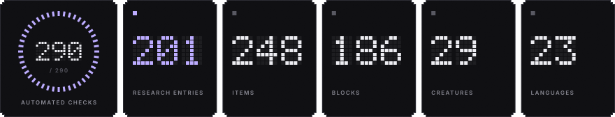
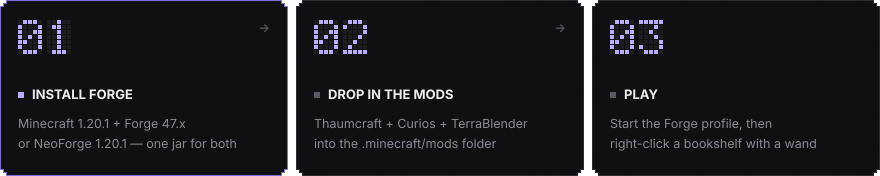

<p align="center">
  
</p>

<p align="center">
  <b>English</b> &nbsp;·&nbsp; <a href="README.ru.md">Русский</a>
</p>

<p align="center">
  
</p>

An unofficial fan port of **Thaumcraft 4** (Minecraft 1.7.10) by Azanor to **Minecraft 1.20.1 / Forge**.
Mechanics, textures, models, sounds and the Thaumonomicon texts are carried over from the original; the code is rewritten for the modern game.
This project is not affiliated with or endorsed by Azanor.

## ▪ Install in 3 steps

<p align="center">
  
</p>

1. **Install Forge or NeoForge.** Download the installer for **Minecraft 1.20.1** — [Forge 47.x](https://files.minecraftforge.net/net/minecraftforge/forge/index_1.20.1.html) (tested on 47.4.0) or [NeoForge 1.20.1](https://neoforged.net/) (tested on 47.1.106) — run it and choose *Install client*. The same mod jar works on both.
2. **Drop in the mods.** Put three jars into your `mods` folder (on Windows: `Win+R` → `%appdata%\.minecraft\mods`):
   - `thaumcraft4-1.20.1-<version>.jar` from the [Releases](../../releases) page;
   - [Curios API](https://www.curseforge.com/minecraft/mc-mods/curios) 5.9 or newer for Forge 1.20.1 — slots for rings, amulets and belts;
   - [TerraBlender](https://www.curseforge.com/minecraft/mc-mods/terrablender) 3.0.1.7 or newer for Forge 1.20.1 — places the new biomes.
3. **Play.** Pick the *forge* profile in the launcher and start the game. Craft a wand and right-click a bookshelf with it — that gives you the **Thaumonomicon**, the in-game guide to everything else.

For a server, put the same three jars into the server's `mods` folder; every player needs them too.

## ▪ What is inside

| | |
|---|---|
| **Research** | Thaumonomicon with 6 categories and 201 entries, the research table minigame, thaumometer scanning, 50 aspects, forbidden knowledge and warp |
| **Thaumaturgy** | Wands, staves and sceptres from 9 rods and 6 caps, 10 foci, the focal manipulator with upgrades, aura nodes, node jars, stabilizers, transducers and vis relays |
| **Alchemy** | Crucible, essentia, jars and labels, tubes, centrifuge, thaumatorium, alchemical furnaces, metal purification and transmutation |
| **Artifice** | Infusion altar and infusion enchanting, runic shield, thaumium and void metal gear, goggles of revealing, hover harness, arcane bore, mirrors, warded arcana |
| **Golemancy** | 8 golem materials, cores, upgrades and accessories, the crystal bell, the traveling trunk |
| **World** | Magical Forest, Eerie and Tainted biomes, greatwood and silverwood, crystal ores, cinnabar and amber, taint and its creatures, champion mobs |
| **Eldritch** | Obelisks, the Crimson Cult, the Outer Lands dimension with its labyrinth and four bosses |

Modern additions: Curios slots instead of Baubles, deepslate ore variants, spawn eggs for every creature, Forge tags for ores and metals,
and optional tin, silver and lead content that appears only when another mod adds those metals.

## ▪ Compatibility

The mod uses standard Forge 1.20.1 mechanisms, so most content mods should simply coexist with it.

| Area | What to expect |
|---|---|
| **Forge / NeoForge** | One jar for both. All 290 automated scenarios pass on Forge 47.4.0 and on NeoForge 1.20.1 (47.1.106). |
| **Curios** | Required. Baubles go into Curios slots and work alongside other Curios mods. |
| **World generation** | Biomes are added through TerraBlender and do not replace other mods' biomes. Ores are tagged (`forge:ores/...`) so other mods can recognise them. |
| **Metals from other mods** | Tin, silver and lead clusters, nuggets, wand caps and research unlock automatically if a mod provides those metals via Forge tags. |
| **Inventories** | Chests, the traveling trunk and other item containers use vanilla-style inventories, so hoppers, pipes and Create funnels can access them. Essentia is Thaumcraft-only. |
| **Create and other "moving block" mods** | Not tested. Avoid moving multiblock structures (infusion altar, thaumatorium, alchemical constructs), aura nodes and warded blocks with contraptions — they may lose their state. |
| **Renderer and shader mods** | Not tested. Embeddium, Oculus or OptiFine may change how nodes, portals and particles look. |
| **Other Thaumcraft ports** | Cannot be installed together: both use the mod id `thaumcraft`. |

## ▪ Status

**Early release — playable, not yet battle-tested.**
All content of the original is ported, and 290 automated in-game scenarios (crafting, rituals, mobs, bosses, world generation, GUIs) pass on every build.
Not tested yet: long survival playthroughs, dedicated multiplayer servers, large modpacks. Keep backups of your worlds and report problems in [Issues](../../issues).

**Languages:** English, Russian and Ukrainian are complete. 20 more languages come from the original's community translations; strings that are new in this port fall back to English there.

## ▪ Screenshots

<table>
<tr><td width="50%"><br><sub>The Thaumonomicon research map</sub></td><td width="50%"><br><sub>A book page about aspects</sub></td></tr>
<tr><td width="50%"><br><sub>Infusion in progress</sub></td><td width="50%"><br><sub>Outer Lands: the Eldritch Warden</sub></td></tr>
<tr><td width="50%"><br><sub>Crimson Cult praetor</sub></td><td width="50%"><br><sub>Silverwood and greatwood</sub></td></tr>
<tr><td width="50%"><br><sub>Tainted land and its creatures</sub></td><td width="50%"><br><sub>Wand of fire</sub></td></tr>
</table>

## ▪ Build from source

Requires JDK 17.

```bash
./gradlew build
```

The jar appears in `build/libs`. `./gradlew runClient` starts a development client.

## ▪ Credits

- **Azanor** — creator of Thaumcraft: design, code, textures, models, sounds and texts of the original.
- Translators of the original's language files.
- This port: rewritten code and adaptation to Minecraft 1.20.1.

All rights to Thaumcraft and its original assets belong to their author. This is a non-commercial fan project.
If you are the rights holder and object to it, please open an issue.
