<p align="center">
  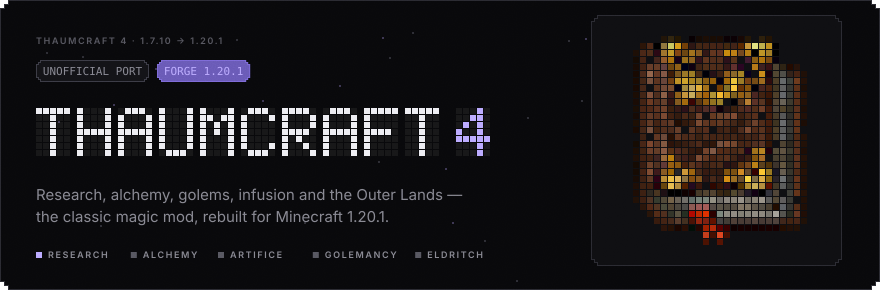
</p>

<p align="center">
  <a href="README.md">English</a> &nbsp;·&nbsp; <b>Русский</b>
</p>

<p align="center">
  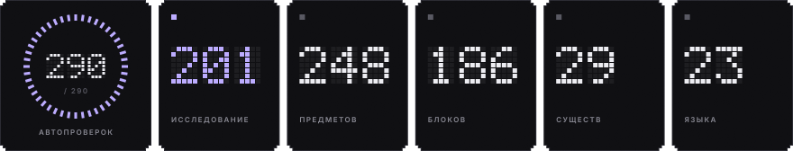
</p>

Неофициальный фанатский порт **Thaumcraft 4** (Minecraft 1.7.10) от Azanor на **Minecraft 1.20.1 / Forge**.
Механики, текстуры, модели, звуки и тексты Таумономикона перенесены из оригинала, код переписан под современную игру.
Проект не связан с Azanor и не одобрен им.

## ▪ Установка в 3 шага

<p align="center">
  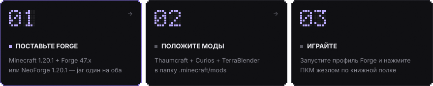
</p>

1. **Поставьте Forge или NeoForge.** Скачайте установщик для **Minecraft 1.20.1** — [Forge 47.x](https://files.minecraftforge.net/net/minecraftforge/forge/index_1.20.1.html) (проверено на 47.4.0) или [NeoForge 1.20.1](https://neoforged.net/) (проверено на 47.1.106), — запустите и выберите *Install client*. Один и тот же jar мода работает на обоих.
2. **Положите моды.** Скопируйте три файла в папку `mods` (в Windows: `Win+R` → `%appdata%\.minecraft\mods`):
   - `thaumcraft4-1.20.1-<версия>.jar` со страницы [Releases](../../releases);
   - [Curios API](https://www.curseforge.com/minecraft/mc-mods/curios) 5.9 или новее для Forge 1.20.1 — ячейки для колец, амулетов и поясов;
   - [TerraBlender](https://www.curseforge.com/minecraft/mc-mods/terrablender) 3.0.1.7 или новее для Forge 1.20.1 — добавляет новые биомы.
3. **Играйте.** Выберите в лаунчере профиль *forge* и запустите игру. Сделайте жезл и нажмите им ПКМ по книжной полке — получите **Таумономикон**, внутриигровой справочник по всему остальному.

Для сервера положите те же три файла в папку `mods` сервера; у каждого игрока они тоже должны стоять.

## ▪ Что внутри

| | |
|---|---|
| **Исследования** | Таумономикон: 6 разделов и 201 запись, мини-игра на столе исследований, сканирование таумометром, 50 аспектов, запретные знания и искажение |
| **Тауматургия** | Жезлы, посохи и скипетры из 9 стержней и 6 наконечников, 10 набалдашников, верстак улучшений, узлы ауры, узлы в банках, стабилизаторы, преобразователи и вис-каналы |
| **Алхимия** | Тигель, эссенция, банки и бирки, трубы, центрифуга, тауматорий, алхимические печи, очистка и трансмутация металлов |
| **Артефакты** | Алтарь наполнения и зачарование наполнением, рунный щит, снаряжение из таумия и пустотного металла, очки откровения, таумостатический ранец, магический бур, зеркала, защищённые блоки |
| **Големы** | 8 материалов, сердца, улучшения и аксессуары, хрустальный колокольчик, ходячий сундук |
| **Мир** | Волшебный лес, жуткие и порченые земли, великое и серебряное дерево, кристальные руды, киноварь и янтарь, порча и её существа, мобы-чемпионы |
| **Древние** | Обелиски, Багровый культ, измерение Запредельных земель с лабиринтом и четырьмя боссами |

Современные дополнения: дерево из **25 достижений**, которое ведёт новичка от первого жезла до Запредельных земель, **поддержка JEI** (рецепты магического верстака, тигля и наполнения; аспекты как ингредиенты JEI — R на аспекте покажет, из каких предметов его взять, U — где он тратится; подсказки к вещам, которые делаются щелчком жезла), ячейки Curios вместо Baubles, руды в глубинном сланце, яйца призыва для всех существ, теги Forge для руд и металлов
и необязательный контент для олова, серебра и свинца — он появляется, только если эти металлы добавляет другой мод.

## ▪ Совместимость

Мод использует стандартные механизмы Forge 1.20.1, поэтому большинство контентных модов должны уживаться с ним без проблем.

| Что | Чего ждать |
|---|---|
| **Forge / NeoForge** | Один jar на оба. Все 290 автоматических сценариев проходят и на Forge 47.4.0, и на NeoForge 1.20.1 (47.1.106). |
| **JEI** | Необязателен. Показывает рецепты магического верстака, тигля и наполнения с висом, эссенцией и исследованием, объясняет превращения щелчком жезла. Вещи отсутствующих металлов скрыты. |
| **Curios** | Обязателен. Украшения занимают ячейки Curios и работают вместе с другими модами на Curios. |
| **Генерация мира** | Биомы добавляются через TerraBlender и не вытесняют биомы других модов. Руды помечены тегами (`forge:ores/...`), их узнают другие моды. |
| **Металлы из других модов** | Кластеры, самородки, наконечники и исследования для олова, серебра и свинца открываются сами, если какой-то мод добавляет эти металлы через теги Forge. |
| **Инвентари** | Сундуки, ходячий сундук и другие хранилища предметов устроены как ванильные, поэтому к ним подключаются воронки, трубы и воронки Create. Эссенция — только для устройств Thaumcraft. |
| **Create и другие моды, двигающие блоки** | Не проверено. Не двигайте механизмами многоблочные конструкции (алтарь наполнения, тауматорий, алхимические конструкции), узлы ауры и защищённые блоки — они могут потерять состояние. |
| **Моды рендера и шейдеры** | Не проверено. Embeddium, Oculus или OptiFine могут изменить вид узлов, порталов и частиц. |
| **Другие порты Thaumcraft** | Вместе не встанут: у обоих id мода `thaumcraft`. |

## ▪ Состояние

**Ранний релиз — играть можно, но обкатки ещё не было.**
Весь контент оригинала перенесён, и на каждой сборке проходят 290 автоматических сценариев в игре (рецепты, ритуалы, мобы, боссы, генерация мира, интерфейсы).
Ещё не проверено: долгое выживание, выделенные серверы, большие сборки модов. Делайте резервные копии миров и пишите о проблемах в [Issues](../../issues).

**Языки:** английский, русский и украинский — полностью. Ещё 20 языков взяты из переводов сообщества к оригиналу; новые строки порта в них показываются по-английски.

## ▪ Скриншоты

<table>
<tr><td width="50%">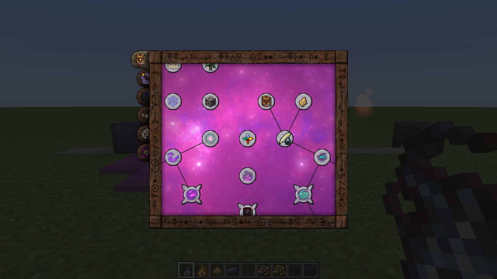<br><sub>Карта исследований в Таумономиконе</sub></td><td width="50%">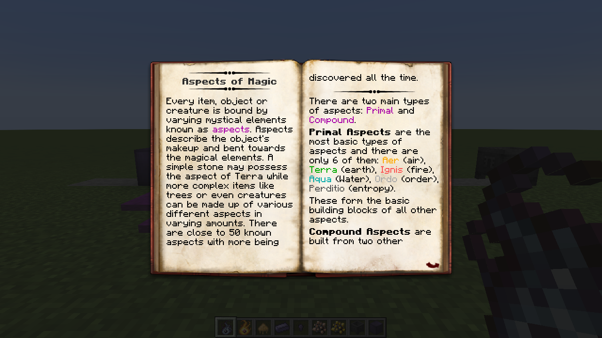<br><sub>Страница книги об аспектах</sub></td></tr>
<tr><td width="50%">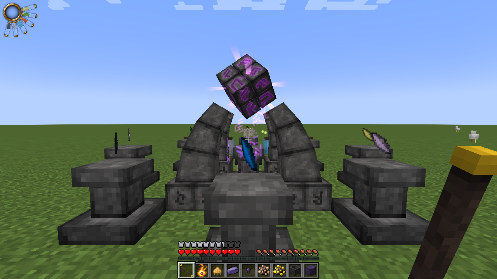<br><sub>Идёт наполнение на алтаре</sub></td><td width="50%">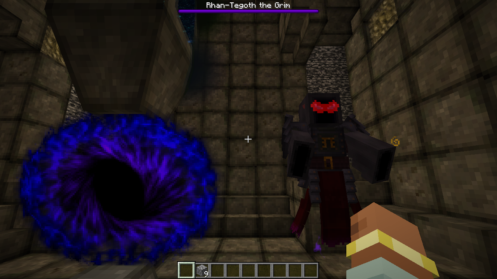<br><sub>Запредельные земли: Надзиратель Элдрича</sub></td></tr>
<tr><td width="50%">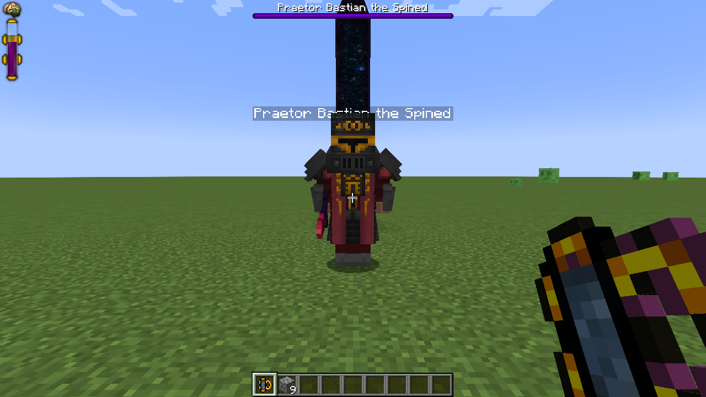<br><sub>Багровый претор</sub></td><td width="50%">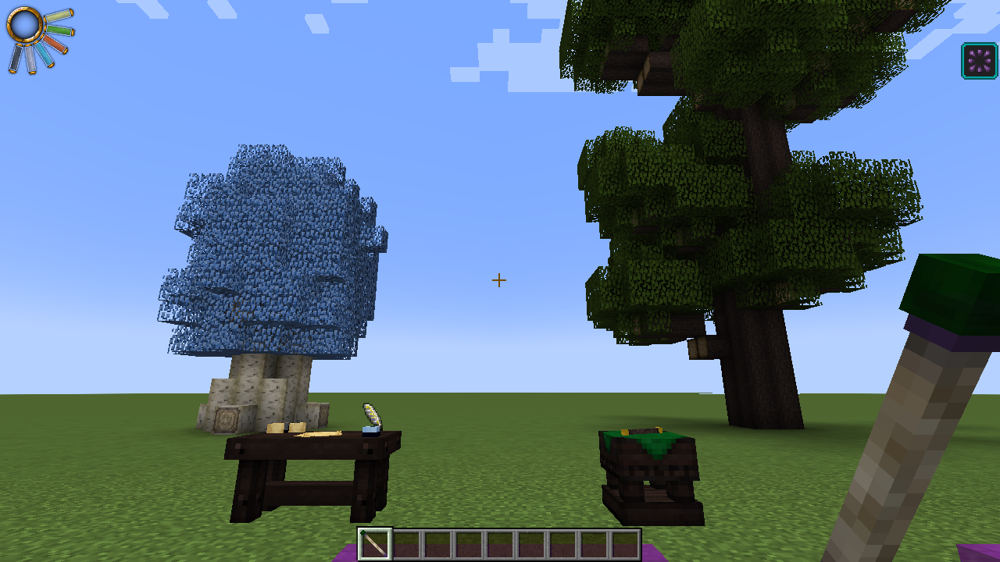<br><sub>Серебряное и великое дерево</sub></td></tr>
<tr><td width="50%">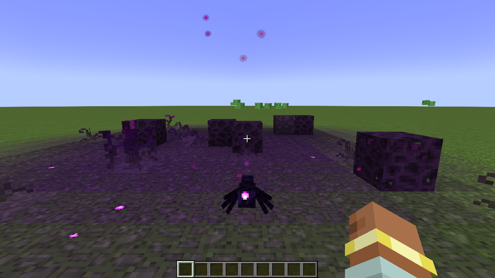<br><sub>Порченые земли и их существа</sub></td><td width="50%">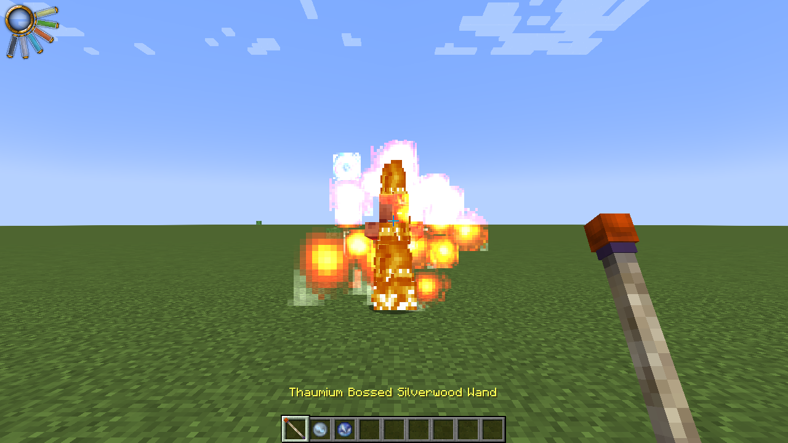<br><sub>Жезл с огненным набалдашником</sub></td></tr>
</table>

## ▪ Сборка из исходников

Нужен JDK 17.

```bash
./gradlew build
```

Готовый jar появится в `build/libs`. `./gradlew runClient` запускает клиент для разработки.

## ▪ Авторы

- **Azanor** — автор Thaumcraft: дизайн, код, текстуры, модели, звуки и тексты оригинала.
- Переводчики языковых файлов оригинала.
- Этот порт: переписанный код и адаптация под Minecraft 1.20.1.

Все права на Thaumcraft и его оригинальные ресурсы принадлежат автору. Это некоммерческий фанатский проект.
Если вы правообладатель и против его публикации — откройте issue.
